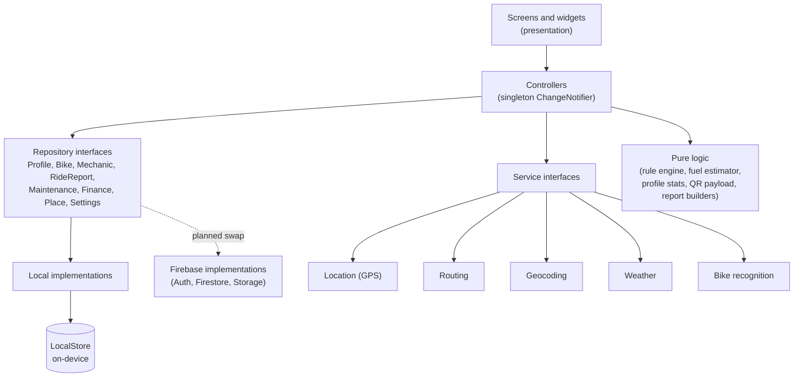

# CAMP: Context-Aware Predictive Maintenance
 
[](https://flutter.dev)
[](https://dart.dev)
[](https://firebase.google.com)
[](mobile/test/)
[](mobile/analysis_options.yaml)
 
A Flutter mobile app for adventure motorcyclists in Pakistan. CAMP keeps track of your bike, your service schedule, your fuel and your costs, and gives you an emergency card you can print and stick on your bike or helmet.
 
> **100% software-based.** No OBD-II, no ECU polling, no tyre-pressure sensors, no Bluetooth hardware, no satellite links. Every number in the app comes from what the rider entered, the phone's GPS and sensors, or a documented formula.
 
> Final Year Project, BSCS, University of Lahore (2026). Team: Uzair Ahmad Khan, Hassan, Ali Moeed. Supervisor: Ma'am Aqsa Shahzad.
 
<p align="center">
  
  
  
  
</p>
<!-- Add 4 to 6 phone screenshots to docs/screenshots/ with the names above. Demo video: [Watch the demo](LINK) -->
 
---
 
## What it does
 
| Area | What you can do | Status |
|---|---|---|
| **Garage** | Add bikes (make, model, year, plate, colour, photo) and switch the active bike | ✅ Working |
| **Live fuel estimate** | Fuel level and range from GPS distance and your bike's average; low-fuel notification at 15% | ✅ Working |
| **Maintenance** | Log services with your own cost and shop; see what is due; PDF report | ✅ Working. 🔧 Rider-set service schedule in progress |
| **Finances** | Trip budgets and expenses in PKR, cost per km, category breakdown, PDF report, planned service visit | ✅ Working |
| **Mechanics** | Save workshops with photo, phone and opening hours; call them; "Added by you" badges | ✅ Working |
| **Emergency SOS** | Call the local emergency number (1122 by default), message your emergency contact with a Maps link, medical ID | ✅ Working |
| **Emergency QR** | A real, scannable QR card (name, blood group, allergies, emergency contact, bike) saved as PNG or PDF; works offline | ✅ Working |
| **Profile** | Tier and badges computed from your real ride totals | ✅ Working |
| **Navigation and maps** | Route preview, speedometer, Google Maps hand-off | 🔧 Being rebuilt |
| **Bike scanner** | Add a bike from a photo | 🔧 Sample suggestion only; recognition model planned |
| **Weather** | Conditions with an API key; a clear "unavailable" state without one | 🔧 In progress |
| **Accounts and cloud sync** | Firebase Auth, Firestore sync, shared mechanics directory | 🗓 Planned |
| **Voice copilot** | Control the app by voice command | 🗓 Planned |
 
---
 
## How it works
 
**Rule-based maintenance.** The rider sets how often each item is serviced (for example engine oil every 1,500 km and tuning every 10,000 km). CAMP calculates the next due odometer reading, marks each item Overdue, Due soon or OK, and estimates a date from the rider's real average daily distance. It is a transparent rule engine, not machine learning, and it never invents a cost.
 
**Live fuel estimate.** The phone's GPS stream is filtered (poor accuracy, jitter and impossible speeds are rejected). Accepted distance updates the odometer and reduces the fuel estimate using the bike's average. Full-to-full refills let the rider refine that average.
 
**Honest data rules.** No demo data in release builds, no fabricated prices, no sensor claims, and every empty state says what is missing.
 
---
 
## Monorepo structure
 
```text

CAMP/
├── mobile/                  # Flutter mobile application
│   ├── android/             # Android native configuration and build scripts
│   ├── ios/                 # iOS native configuration and Xcode workspace
│   ├── assets/              # App assets and static resources
│   │   ├── ai/              # AI models, offline embeddings, and prompts
│   │   ├── icons/           # UI & system icon sets
│   │   ├── images/          # Illustration & raster graphics
│   │   ├── map/             # Map styles, vector tiles & markers
│   │   └── seed_data/       # Mock data and offline catalog seeds
│   ├── lib/
│   │   ├── app/             # Application lifecycle & global setups
│   │   │   ├── config/      # Environment & runtime configurations
│   │   │   ├── router/      # Navigation routing & deep links
│   │   │   └── theme/       # Design tokens, themes & typography
│   │   ├── core/            # Shared cross-cutting modules
│   │   │   ├── constants/   # App-wide constants & assets references
│   │   │   ├── database/    # Local persistence (Drift / Floor / SQLite)
│   │   │   │   ├── daos/    # Data Access Objects
│   │   │   │   └── tables/  # Database schema definitions
│   │   │   ├── network/     # HTTP clients, interceptors & error handlers
│   │   │   ├── services/    # Location, Bluetooth, Sensor & Background services
│   │   │   └── utils/       # Formatters, loggers, validation helpers
│   │   ├── features/        # Feature-first modular domain slices
│   │   │   ├── auth/            # Authentication & Onboarding
│   │   │   ├── dashboard/       # Central status, telemetrics & summary
│   │   │   ├── bike_scan/       # Vision AI vehicle scanner & diagnostics
│   │   │   ├── garage/          # Vehicle inventory & parts registry
│   │   │   ├── navigation/      # Turn-by-turn routing & offline maps
│   │   │   ├── mechanics/       # Nearby workshops & specialist finder
│   │   │   ├── maintenance/     # Wear-and-tear tracking & service schedules
│   │   │   ├── ride_history/    # Trip telemetry, routes & stats
│   │   │   ├── emergency_sos/   # Crash detection & emergency dispatches
│   │   │   ├── voice_copilot/   # Hands-free audio assistant & feedback
│   │   │   └── settings/        # Preferences & profile configuration
│   │   │   # (Each feature includes: controllers/, domain/, presentation/)
│   │   └── main.dart        # Flutter entrypoint
│   ├── test/                # Unit, widget, and integration tests
│   ├── pubspec.yaml         # Flutter dependencies
│   └── analysis_options.yaml# Dart static analysis configuration
│
├── backend/                 # Backend API services & functions
│   ├── config/              # Server configuration & environment validation
│   ├── functions/           # Cloud Functions / Serverless handlers
│   │   └── src/
│   │       ├── maintenance_rules/ # Automated maintenance triggers
│   │       └── sync/        # Cloud-to-local bidirectional sync
│   └── src/
│       ├── middlewares/     # Auth, validation, error-handling middlewares
│       ├── modules/         # Domain modules (elevation, mechanics, routes)
│       └── routes/          # REST & WebSocket endpoint definitions
│
├── firebase/                # Firebase configs, rules, and deployment specs
├── .gitignore               # Root monorepo Git exclusion rules
└── README.md              ← This file
```
 
---
 
## Architecture
 

 
**Repository layer.** Screens never touch storage. Controllers receive repositories through an `AppRepositories` provider created in `main.dart`. Every model has a stable `id`, `createdAt` and `updatedAt`, and tolerant JSON so old data keeps loading. Moving to Firebase means writing new repository implementations, not changing screens.
 
**Feature module pattern.** Each feature under `mobile/lib/features/<name>/` has the same layers:
 
```text
features/<name>/
├── domain/        ← Models and pure logic (no Flutter imports)
├── controllers/   ← ChangeNotifier state managers between domain and UI
└── presentation/
    ├── screens/   ← Full-page widget trees
    └── widgets/   ← Smaller components
```
 
**Pure logic is separate and tested.** The rule engine, fuel estimator, tier and badge rules, QR payload builder and PDF report builders are plain Dart with unit tests.
 
**Persistence.** `core/storage/local_store.dart` wraps `SharedPreferences` with an ordered write queue, a `flush()` that is called when the app goes to the background, and schema versioning. Only the data layer uses it.
 
**Navigation shell.** One bottom dock with six tabs, driven by a `CampTab` enum.
 
---
 
## Tech stack
 
| Layer | Technology |
|---|---|
| Mobile framework | Flutter · Dart `^3.13.4` |
| State management | `ChangeNotifier` singleton controllers |
| Data access | Repository pattern with local implementations |
| Offline persistence | `SharedPreferences` via `LocalStore` |
| Maps and navigation | `flutter_map` (OSM) · OSRM routing · Nominatim geocoding |
| Location | `geolocator` (foreground service for ride tracking) |
| Camera and photos | `camera` · `image_picker` |
| Output | `qr_flutter` · `pdf` · `printing` and share/save packages |
| Notifications | `flutter_local_notifications` |
| Typography | Google Fonts: Manrope · Teko · Share Tech Mono |
| UI design | Skeuomorphic clay design system (AppColors, AppTextStyles) |
| Auth, database, storage | Firebase Auth · Cloud Firestore · Firebase Storage *(planned)* |
 
---
 
## Getting started
 
```bash
cd mobile
flutter pub get
flutter run
```
 
Optional weather key (never commit keys):
 
```bash
flutter run --dart-define=WEATHER_API_KEY=your_key_here
```
 
Debug builds show clearly labelled demo data. Release builds start empty.
 
**Verify:**
 
```bash
flutter analyze        # 0 issues expected
flutter test           # all tests passing
flutter build apk --debug
```
 
The tests cover the rule engine, fuel estimator, profile stats and badges, PKR formatting, report builders and screen states. The emergency QR is verified by decoding the generated image and comparing it with its payload.
 
---
 
## Current status
 
| Area | Status |
|---|---|
| Garage, Mechanics, Finances, SOS, Emergency QR, Profile | ✅ Working on a physical Android 12 phone |
| Repository layer (all data behind interfaces) | ✅ Complete |
| Currency in PKR; costs entered by the rider | ✅ Complete |
| Flutter analyze | ✅ 0 issues |
| Automated tests | ✅ 230+ passing |
| Home, maintenance schedule, ride and settings screens | 🔧 In progress |
| Navigation rebuild and ride tracker | 🔧 In progress |
| Firebase Auth, Firestore sync, shared mechanics directory | 🗓 Planned |
 
---
 
## Known limitations
 
- Phone GPS only. There is no engine data, so no RPM or live diagnostics.
- Background tracking can be stopped by aggressive battery savers on some phones (for example Xiaomi). Set the app's battery saver to "No restrictions".
- Routing needs an internet connection.
- Data is stored on the device until the Firebase phase.
---
 
## Roadmap
 
1. Finish the screen fixes (Home, service schedule, ride and settings screens).
2. Rebuild navigation around one ride tracker, with fuel averages per speed band.
3. Firebase: sign-in, cloud sync of profile, bikes, maintenance and expenses, a shared mechanics directory, photo storage.
4. Voice commands and a bike recognition model.
5. Future work: elevation-aware fuel and wear estimates.
---
 
## Team
 
| Name | Role |
|---|---|
| Uzair Ahmad Khan | Architecture, data layer, maintenance and fuel logic, testing |
| Hassan | Screens and authentication |
| Ali Moeed | Screens and settings |
 
<!-- Adjust the roles to what each person actually built. Add a license before making the repo public. -->
 
